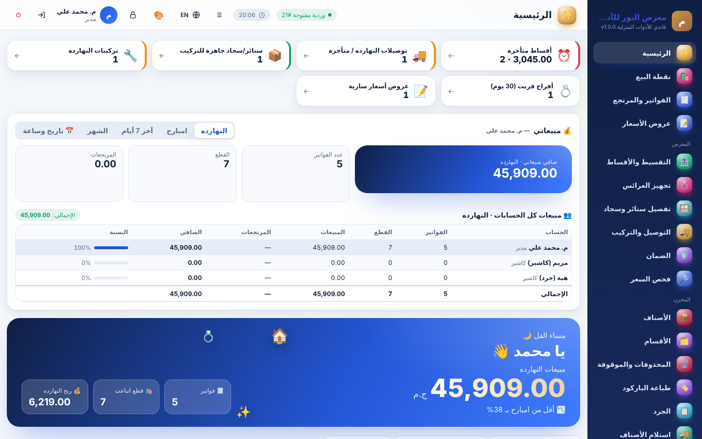
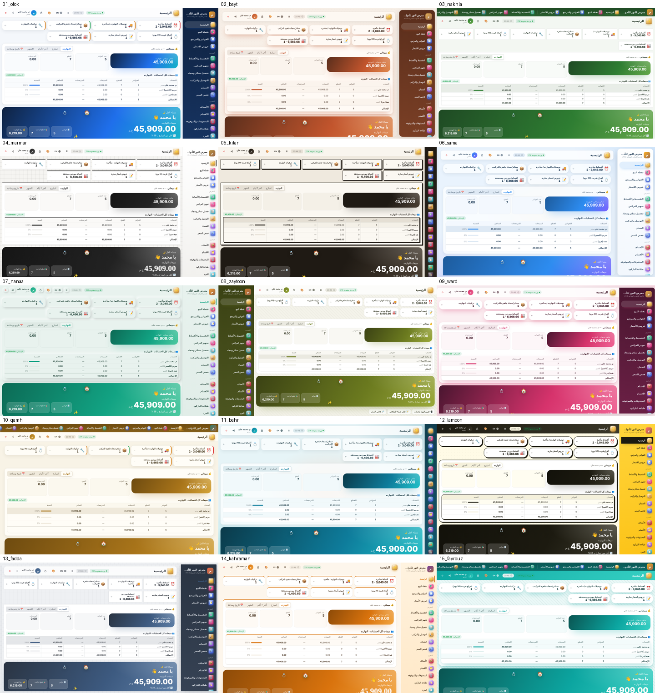
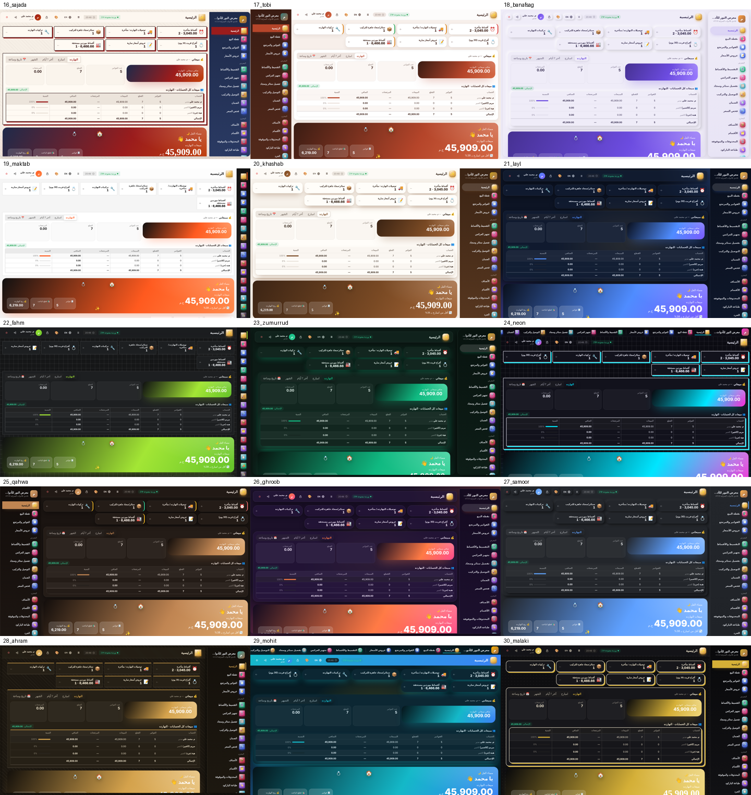

# غاندي للأدوات المنزلية — Ghandi Home
**نظام إدارة معارض الأدوات المنزلية والأجهزة الكهربائية وتجهيز العرائس والسجاد والستائر**
أوفلاين بالكامل لويندوز 7 / 8 / 10 / 11 — برمجة وتطوير: **م. محمد علي — 01098811581**
الإصدار الحالي: **1.9.0**






## 📦 الجاهز للتسليم — `releases/`
| الملف | لمين |
|---|---|
| `Ghandi-Home-Setup-1.9.0.exe` | النسخة الكاملة لأي معرض جديد |
| `Ghandi-Home-Update-1.9.0.exe` | تحديث للمعارض اللي عندها إصدار قديم (بيحافظ على البيانات والتفعيل) |
| `Ghandi-Home-Keygen-OWNER-ONLY.html` | مولّد أكواد التفعيل — للمطوّر بس |
| `دليل-صاحب-المحل-غاندي-للأدوات-المنزلية.pdf` | لصاحب المحل — الشرح الكامل بالصور (57 صفحة) |
| `Ghandi-Home-دليل-التسطيب-والتفعيل-والاستخدام.pdf` | دليل مختصر |

> 🔒 المستودع ده لازم يفضل **Private** — فيه المولّد والمفاتيح السرية (`build/keys.json`، `build/dev-cred.json`).

## ✨ المميزات
- **نقطة بيع** بالباركود، 4 أسعار (قطاعي / نص جملة / جملة / خاص)، خصم بحد لكل موظف، آجل، مرتجع واستبدال، تعليق فواتير، درج كاش، شاشة عميل.
- **البيع بالمتر**: سجاد رول بالمتر المربع (طول × عرض) وقماش ستائر ومجاري بالمتر الطولي.
- **التقسيط**: مقدم + شهور + نسبة زيادة، ضامنين، جدول أقساط، عقد A4، إيصالات تحصيل، غرامة تأخير، سداد مبكر، تذكير واتساب، تقرير تحصيل.
- **تجهيز العرائس**: ملف لكل عروسة بميعاد الفرح وقائمة الجهاز، حجز، دفعات تحت الحساب، تسليم على مراحل.
- **تفصيل ستائر وسجاد**: حساب القماش والبطانة والمجرى والمصنعية تلقائي، مراحل الشغل، أمر ورشة.
- **التوصيل والتركيب** بمواعيد وإذن تسليم وخط سير · **عروض الأسعار** · **مخازن متعددة وتحويل** · **الضمان**.
- **الأسعار**: رفع/تخفيض جماعي، عروض، كوبونات · **الجرد** · **العملاء وكشف حساب A4** · الموردين · المصروفات · الورديات · التقارير والأرباح.
- **فاتورة A4 احترافية** بالتفقيط والضمان والشروط والتوقيعات، أو حرارية 80/58 مم.
- **صلاحيات تفصيلية** لكل موظف، و**لوحة مطوّر** تتحكم في المميزات والمدير والموظفين.
- **نسخ احتياطي** تلقائي جنب البرنامج + 3 أماكن بيختارها صاحب المحل، وبيانات مشفّرة.
- **جديد 1.1:** كمبيالات وإيصال أمانة · رقم السيريال للأجهزة · كشف تحصيل للمحصّل · عمولات البائعين · باكدجات العرائس · أقساط الموردين.
- **جديد 1.2:** 30 تصميم كامل (مكان القائمة، الكروت، الزوايا، الخطوط، الخلفيات، الألوان) يختارها المدير من الإعدادات.
- **جديد 1.3:** صفحة حساب كاملة لكل مورد — الفواتير والحركات والتسديدات والملاحظات، كشف حساب A4، طباعة فواتير الشراء.
- **جديد 1.4:** 6 تصميمات للفواتير وعروض الأسعار، كل الكلام والشروط قابلة للتعديل، معاينة قبل الطباعة، وأدوات تصفير في لوحة المطوّر.
- **جديد 1.6:** محرر الفاتورة المباشر (أي تغيير يظهر فوراً، ودوس على أي كلمة في الورقة تغيّرها أو تخفيها أو تمسحها) + قاعدة من المطوّر تمنع حفظ سعر قطاعي أقل من التكلفة.
- **جديد 1.5:** بيانات العميل الكاملة (رقم قومي، عنوان، شغل، قريب، صورة البطاقة، نوع العميل، حد الآجل) وملف العميل A4.
- **التفعيل أوفلاين** ببصمة الجهاز وبمدة (تجربة / شهر / سنة / مدى الحياة).

## 🗂️ تنظيم المشروع
| الفولدر | فيه إيه |
|---|---|
| `app/` | كود البرنامج — ملفات المعرض الجديدة: `js/home-core.js` · `home-inst.js` · `home-bride.js` · `home-orders.js` · `home-extra.js` · `home-designs.js` · `home-suppliers.js` · `home-print.js` · `home-cust.js` · `css/home.css` |
| `desktop/` | `main.js` بتاع Electron (الطباعة، PDF، الدرج، شاشة العميل، التحقق من التوقيع) |
| `build/` | سكريبتات البناء والاختبار وملفات المثبّت NSIS وصور الشرح |
| `docs/` | مصدر الدليل |
| `toolchain/` | Electron 22 (آخر نسخة بتدعم ويندوز 7) و NSIS |

## ▶️ تجربة في المتصفح
`app/index.html?demo` في جوجل كروم — الدخول `admin` / `1234`.

## 🔨 البناء
محتاج Node.js 18+ على لينكس/WSL، والملفات السرية في `build/` (`keys.json` و`dev-cred.json`).
```
node build/make-keys.js        # يكتب pubkey.js و lk.js من keys.json (من غير --force)
node build/make-devcred.js     # يكتب devcred.js من dev-cred.json
LANG=C.UTF-8 node build/build-desktop.js win32
```
بيطلع في `dist/`: `Ghandi-Home-Setup-X.exe` (كامل) و`Ghandi-Home-Update-X.exe` (تحديث صغير بيحافظ على البيانات والتفعيل).

⚠️ ماتشغّلش `make-keys.js --force` — بيعمل مفاتيح جديدة وكل أكواد التفعيل القديمة تبطل.

## 📘 دليل صاحب المحل
`node build/manual/shoot.js` (صور الشاشات بالأرقام) ثم `node build/manual/firstrun.js` (التفعيل والدخول) ثم `node build/manual/build.js` (يطلع الـ PDF في releases). الشرح والأرقام في `build/manual/spec.js`.

## 🧪 الاختبارات
`node build/hometest.js` (كل شاشات المعرض) و `node build/extra11test.js` (مميزات 1.1) و `node build/designtest.js` (الـ 30 تصميم) و `node build/suptest.js` (حسابات الموردين) و `node build/printtest.js` (الطباعة والتصفير) و `node build/custtest.js` (بيانات العميل) و `node build/a4test.js` (كل مستندات A4).
